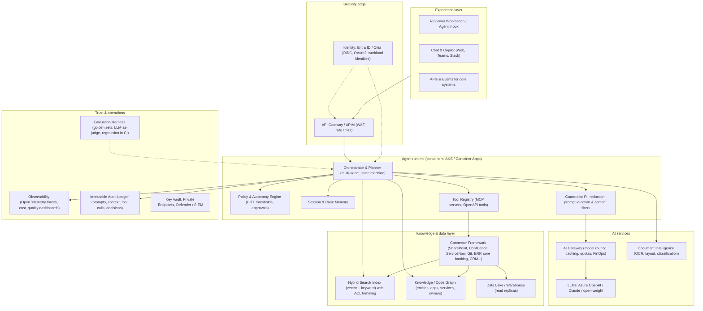

# AI Implementation Accelerators — Production-Grade by Design

> **Goal:** Cut the cost and effort of AI pilots by **~50% for reusable ("canned") use cases**, while building on **production-grade architecture and engineering practices**, so that a successful pilot is **extended into production rather than discarded and rebuilt.**
> **Cloud:** Azure-first reference implementation (Bicep/Terraform), with AWS and GCP variants. **Models:** model-agnostic through an AI gateway (Azure OpenAI, Anthropic Claude, open-weight models).

---

## 1. Design Principles

| # | Principle | What it means in practice |
|---|---|---|
| P1 | **Production-grade from day 1** | Same IaC, CI/CD, identity, network isolation, observability and test discipline in pilot and production. A pilot differs only in *scale settings* and *rollout scope*, not in architecture. |
| P2 | **Configure, don't code** | Use-case packs are mostly configuration: agent definitions, tools, prompts, policies, evaluation sets and UI layouts, in versioned YAML/JSON. Custom code only for genuinely new logic. |
| P3 | **One reference stack** | All agent services use one opinionated stack (e.g. Python/FastAPI for agents, .NET or TypeScript for APIs/UI), so we **do not add another stack** to an estate that already has too many. |
| P4 | **Adapters at the edge** | Heterogeneous systems from acquisitions are reached through a connector/adapter layer. When apps are consolidated later, only adapters change. |
| P5 | **Human-in-the-loop as a platform feature** | Autonomy levels (Assist / Augment / Autonomous) are configured per action, with thresholds, approvals and audit built in. |
| P6 | **Evaluate everything** | Every agent ships with a golden dataset and automated evaluations that run in CI. No prompt or model change ships without passing them. |
| P7 | **Secure & compliant by default** | Least-privilege workload identities, PII redaction, permission-aware retrieval, immutable audit trail, aligned to the NFRs in [01 §C](01-agentic-ai-use-cases.md#c-common-non-functional-requirements-nfrs--applies-to-all-use-cases). |
| P8 | **Model- and cloud-portable** | AI gateway abstraction, open standards (OpenTelemetry, MCP, OpenAPI), and no hard dependency on any one LLM provider. |

---

## 2. Reference Architecture

> **Identity starter:** The identity and API-security layer reuses the patterns in this repository (React SPA + ASP.NET Core MVC + .NET 8 API secured with Microsoft Entra ID: OIDC auth-code + PKCE, confidential client, bearer-token validation with scope checks). These become the **Identity & Access accelerator** for agent UIs and agent-callable APIs, extended with workload identities for agents and on-behalf-of (OBO) flows so that agents act **with the user's entitlements**.

---

## 3. Accelerator Catalogue

### 3.1 Platform accelerators (shared by all use cases)

| ID | Accelerator | What's pre-built | Production-grade elements | Effort saved |
|---|---|---|---|---|
| PA-01 | **Agent Platform Landing Zone** | Bicep/Terraform modules: VNet, private endpoints, AKS/Container Apps, APIM, Key Vault, Storage, Search, monitoring; dev/test/prod parameter sets | Policy-as-code, tagging, CMK option, hub-spoke networking, zero public endpoints | 60–70% |
| PA-02 | **Identity & Access Kit** | Entra ID/Okta OIDC for UIs, OAuth2 scopes for APIs, managed/workload identities for agents, OBO token flow, RBAC role templates, multi-tenant support for acquired entities' directories | Least privilege, conditional access, token validation middleware, tested auth flows | 60–70% |
| PA-03 | **Agent Runtime Framework** | Orchestrator (planner/executor, multi-agent, state machine), tool-calling with retries/idempotency, memory, MCP server templates, autonomy/HITL policy engine | Typed contracts, circuit breakers, compensation for state-changing tools, horizontal scaling | 50–60% |
| PA-04 | **AI Gateway** | Model routing (small vs large models), semantic caching, quotas, fallback across providers/regions, token metering per use case | Zero-retention configuration, rate limiting, FinOps chargeback | 70% |
| PA-05 | **Guardrails & Privacy Pack** | PII/PCI detection and redaction, prompt-injection and jailbreak filters, output policy checks (no advice, financial-promotion rules), tool allow-lists | OWASP LLM Top-10 mapped tests, red-team suite | 60% |
| PA-06 | **Evaluation Harness** | Golden-dataset tooling, metrics (accuracy, groundedness, faithfulness, task success, latency, cost), LLM-as-judge with human calibration, CI gates, A/B and shadow mode | Regression runs on every PR; evaluation reports archived as MRM evidence | 60–70% |
| PA-07 | **Observability & AgentOps** | OpenTelemetry tracing of every agent step, dashboards (quality, cost, latency, override rate), alerting, user-feedback capture | SLOs, on-call runbooks, SIEM export | 60% |
| PA-08 | **Audit & Explainability Ledger** | Append-only store of inputs, retrieved context, tool calls, outputs, confidence, human decision; "explain this decision" view | WORM storage option, retention policies (5–7 yrs), regulator-ready export | 70% |
| PA-09 | **Connector Framework** | Ready connectors: SharePoint/OneDrive, Confluence, Jira, ServiceNow, Google Drive, Teams/Slack, GitHub/GitLab/Azure DevOps, Salesforce/Dynamics, SAP/Oracle/NetSuite/D365, Workday; adapter SDK for core banking, card processors and PSPs | Incremental sync, change capture, ACL sync, back-pressure, connector health monitoring | 50–70% |
| PA-10 | **Reviewer Workbench UI** | React agent-inbox: queue, case view, evidence panel with citations, approve/edit/reject, feedback capture, SLA timers; embeddable in Teams or CRM | WCAG 2.1 AA, Entra-secured, configurable layouts per use case | 60% |
| PA-11 | **DevSecOps Pipeline** | GitHub Actions / Azure DevOps templates: build, unit/integration tests, SAST, dependency/SBOM scanning, container scanning, evaluation gate, IaC deploy, canary release | Branch protection, signed artefacts, environment approvals | 70% |
| PA-12 | **Value Tracking Kit** | Baseline templates, time-and-motion sampler, value dashboard (effort per unit, savings projection 8–12 months), business-case model | Feeds the outcome determination in the pilot | 50% |

### 3.2 Use-case packs (pre-configured, "canned")

Each pack contains: agent definitions, prompt library, tool/connector configuration, reference data schemas, workbench layout, **golden evaluation set (synthetic + public data)**, KPI definitions, risk/MRM documentation template and test suite.

| Pack | Use case | Status | Typical pilot effort with pack vs without |
|---|---|---|---|
| UP-X1 | **Enterprise Knowledge & Expertise Agent** (federated, permission-aware retrieval; conflict detection between entities; expert finder; ticket-to-knowledge-article) | ✅ Ready | 55 vs 130 PD |
| UP-X2 | **Multi-Stack Code Intelligence & Maintenance** (code/architecture graph across .NET/Java/Node/Python/PHP, auto-docs, CVE/dependency upgrade PRs, test generation, app-overlap rationalisation scoring) | ◐ Core ready; stack-specific tuning per client | 100 vs 160 PD |
| UP-C1 | KYC/KYB Onboarding & Screening Disposition | ✅ | ~50% saving |
| UP-C2 | AML Alert Triage & SAR Narrative | ✅ | 75 vs 150 PD |
| UP-C3 | Disputes & Chargeback Representment | ✅ | ~50% saving |
| UP-C6 | Customer Service Agent-Assist & Tier-1 Servicing | ✅ | 60 vs 130 PD |
| UP-C8 | Payment Exceptions & Reconciliation | ✅ | 65 vs 130 PD |
| UP-H1 | AP Invoice-to-Pay | ✅ | 50 vs 110 PD |
| UP-H2 | Close & Balance-Sheet Reconciliation | ✅ | ~50% saving |
| UP-H5 | HR Helpdesk & Onboarding | ✅ | ~55% saving |
| UP-H6 | IT Service Desk & AIOps Triage | ✅ | ~50% saving |
| UP-H10 | RFP / DDQ / Security-Questionnaire Responder | ✅ | ~55% saving |
| — | C4, C5, C7, C9, C10, H3, H4, H7, H8, H9 | ◐ Partial (platform reuse + pattern templates) | 20–35% saving |

---

## 4. Where the ~50% Saving Comes From

| Activity in a typical AI pilot | Share of effort (traditional) | With accelerators | Why |
|---|---:|---:|---|
| Environment, security & identity setup | 15% | 4% | PA-01, PA-02, PA-11 deployed by script into the client tenant in days, not weeks |
| Integration / data connectors | 20% | 11% | PA-09 ready connectors; only client-specific adapters built |
| Agent logic, prompts, tools | 25% | 12% | Use-case packs: configure and tune rather than design from scratch |
| UI / reviewer experience | 10% | 4% | PA-10 configurable workbench |
| Evaluation, testing, guardrails | 15% | 8% | PA-05, PA-06 with ready test suites; only client golden data added |
| Observability, audit, MRM documentation | 10% | 5% | PA-07, PA-08, MRM templates |
| PM, change, value tracking | 5% | 4% | PA-12; change effort stays largely human |
| **Total** | **100%** | **~48%** | |

---

## 5. Engineering & Coding Practices (applied in pilots)

- **Repository structure:** mono-repo per programme: `/infra` (IaC), `/platform` (shared services), `/agents/<use-case>` (config + code), `/connectors`, `/ui`, `/evals`, `/docs`.
- **Code quality:** typed code (Python type hints + mypy / TypeScript strict / C# nullable), linting and formatting enforced in CI, peer-reviewed PRs, coverage targets (≥ 70% on platform code; evaluation coverage for every agent behaviour).
- **Configuration as code:** agents, prompts, tools and policies versioned and promoted through environments; feature flags for autonomy levels.
- **12-factor services:** stateless containers, externalised configuration and secrets, health probes, graceful shutdown.
- **Contracts:** OpenAPI for every service and tool; JSON-schema-validated structured LLM outputs.
- **Resilience:** retries with back-off, timeouts, circuit breakers, idempotency keys, dead-letter queues, provider failover.
- **Security:** threat model per use case; secrets only in Key Vault; dependency pinning and SBOM; container images signed and scanned.
- **Documentation generated in CI:** architecture decision records (ADRs), API docs, runbooks, and MRM model cards per agent.
- **Data handling:** synthetic or pseudonymised data in dev; production-like data only in a controlled test environment approved by Privacy.

---

## 6. Pilot → Production: What Changes

| Area | Pilot (production-grade, limited scope) | Production (extend, don't rebuild) |
|---|---|---|
| Architecture & code | ✅ Same | Same, plus scale-out configuration |
| IaC & CI/CD | ✅ Same pipelines, dev/test environments | Add prod environment, change-management approvals |
| Identity & security | ✅ Entra/Okta, private endpoints, Key Vault | Add pen test, SOC/SIEM onboarding, production access reviews |
| Availability | Single region, business-hours support | Multi-zone/region HA, DR tested to RTO/RPO, 24×7 support |
| Integrations | In-scope slice (limited sources/rails/entities) | Full source/rail/entity coverage; add write-back where approved |
| Autonomy | Assist / Augment with full HITL | Graduated autonomy for low-risk actions after evidence |
| Model risk | Pilot validation evidence (eval reports, model cards) | Formal 2nd-line MRM validation and ongoing monitoring |
| Users | 1–3 pilot teams | Phased rollout with training and SOP updates |
| **Typical incremental effort** | — | **30–50% of a from-scratch build** |

---

## 7. Accelerator Mapping to the Customer's Stated Challenges

| Challenge | Accelerators applied | Lasting asset for the client |
|---|---|---|
| **Knowledge silos across acquired apps** | UP-X1, PA-09 connectors, PA-02 multi-tenant identity + ACL trimming, PA-08 audit | A single, permission-aware knowledge layer across entities. It is reused by every later agent and helps harmonise policies and procedures |
| **Multiple tech stacks, maintenance burden** | UP-X2, PA-11 DevSecOps, PA-06 evaluations (for code-change quality), P3 one reference stack for all AI services | A code and architecture knowledge graph of the estate, a CVE/upgrade automation pipeline, and an **evidence-based application-rationalisation roadmap**, without adding another stack |

---

**Previous:** [04 – Proposal](04-outcome-based-pilot-proposal.md) · **Index:** [README](README.md)
